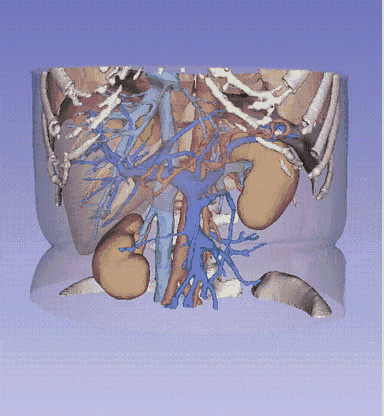

# Pyramid Selection

A [3D Slicer](https://www.slicer.org) extension for interactively selecting a region on a surface model that is
linked to a target by a pyramid-shaped corridor.

The user places a rectangular footprint on the surface. A pyramid joins the footprint to the target's center of mass,
and the surface cells inside that pyramid are extracted as an independent patch. The patch can optionally be colored
by the clearance of a straight path from each cell to the target with respect to obstacle models.

<p align="center">
  
</p>

<p align="center"><em>In this demo, the surface is a skin mesh and the target is a tumor: the user interactively selects an entry region on the skin to visualize and plan a path to the tumor.</em></p>

## Features

- **Pyramid placement:** click on the surface; the footprint is built in the local tangent plane at the closest
  surface vertex.
- **Interactive handles:**
  - yellow center handle: slide the footprint over the surface (it re-orients to the new tangent plane)
  - purple edge handles: resize the footprint symmetrically (it can't collapse or flip).
- **Live update:** the patch is recomputed while you drag (throttled to keep the view smooth). With live update off,
  the patch is hidden during the drag and recomputed after a short pause (150 ms by default).
- **Surface mesh display:** optionally shows the surface semi-transparent with its triangle edges.
- **Patch extraction:** central projection from the target center, limited to the neighbourhood of the footprint so
  the far side of the surface is never selected. "Export patch" copies it into its own model node.
- **Clearance coloring (optional):** for the obstacle models you select, each patch cell is colored from red (the
  straight path to the target crosses or touches an obstacle) through orange to green (the path stays farther than
  the *safe distance*). The scoring is pluggable: see `PyramidSelectionLib/risk.py`.
- **Transforms:** surface, target and obstacles can be under transforms. Moving or editing them updates the pyramid
  and patch automatically.
- Module settings, including the obstacle list, are saved with the scene.

## Usage

1. Load a scene that has a surface model, a target model and, optionally, obstacle models.
2. Open **Pyramid Selection** (category *Surface Models*) and choose the surface and target models.
3. Optionally tick obstacles in **Safety coloring**.
4. Click **Place pyramid**, then click on the surface in the 3D view.
5. Drag the handles. The status line shows the footprint size, the patch size and the computation time.

From the Python console:

```python
import PyramidSelection
logic = PyramidSelection.PyramidSelectionLogic()
logic.setInputs(getNode("MySurface"), getNode("MyTarget"))
logic.setObstacles([getNode("ObstacleA"), getNode("ObstacleB")], safeDistance=10, samples=20)
logic.createSelection([x, y, z], 40, 40)
logic.updatePatch()
```

## Installation (development)

1. Clone this repository.
2. In Slicer: *Edit → Application Settings → Modules → Additional module paths*, add the `PyramidSelection` folder,
   then restart. (Alternatively: *Developer Tools → Extension Wizard → Select Extension* and pick the repository root.)

## Repository layout

```
CMakeLists.txt                  extension metadata
PyramidSelection/
  PyramidSelection.py           Slicer module: widget, logic, self-test
  PyramidSelectionLib/
    geometry.py                 pure NumPy geometry (tangent frame, footprint, edge resizing, projection test)
    surface.py                  cached VTK queries on the surface mesh and patch extraction
    risk.py                     RiskProvider interface and obstacle clearance scoring
  Resources/UI/PyramidSelection.ui
tests/                          pytest tests for PyramidSelectionLib (no Slicer needed)
```

## Testing

Library tests, outside Slicer (need `numpy`, `vtk` and `pytest`):

```bash
python3 -m pytest tests
```

Module self-test, inside Slicer: enable *Developer mode*, open the module, click **Reload and Test**. Or headless:

```bash
Slicer --no-main-window --testing --additional-module-paths PyramidSelection \
  --python-code "import PyramidSelection; PyramidSelection.PyramidSelectionTest().runTest(); slicer.app.exit(0)"
```

## License

TODO: choose a license (Slicer extensions commonly use BSD-3-Clause or Apache-2.0) and add a `LICENSE` file.
